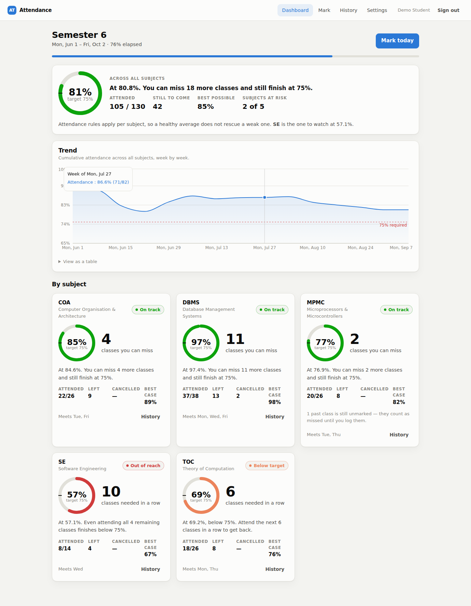
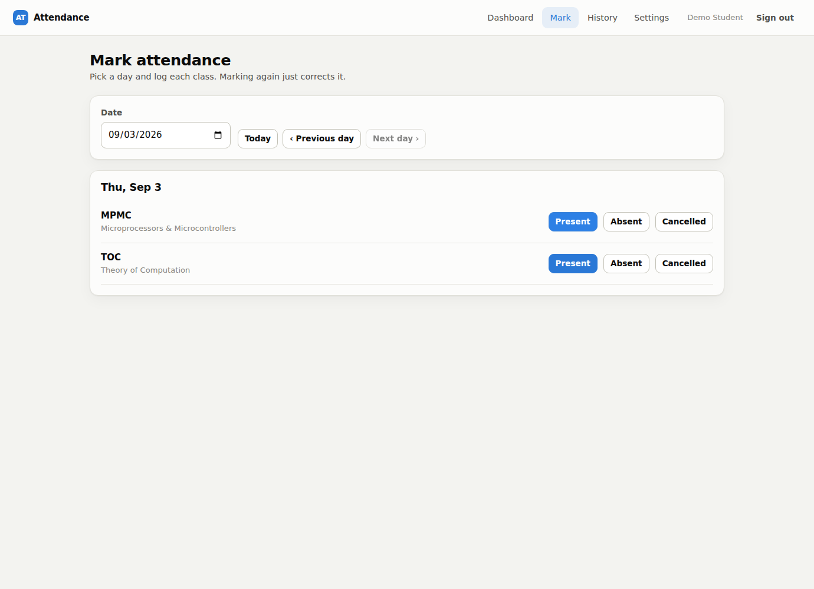
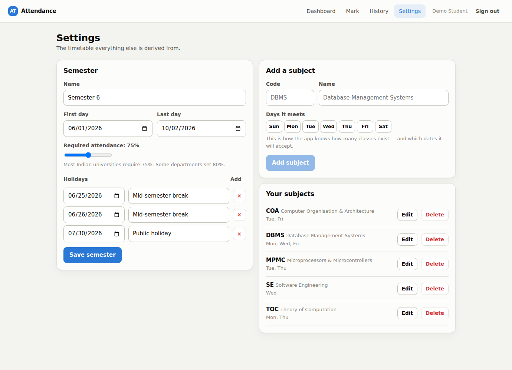

# Attendance — how many classes can I actually miss?

A personal attendance tracker for the question a percentage never answers.
Knowing you are at 73% tells you where you stand. It does not tell you what to
do, because that depends entirely on how much semester is left: 73% in week two
and 73% in week fourteen are completely different situations, and only one of
them is a problem.

So this app answers the useful version instead — **"you can miss 4 more DBMS
classes"**, or **"attend the next 6 TOC classes in a row to get back to 75%"** —
computed from your actual timetable, per subject, with the arithmetic shown.

```bash
npm install
npm run dev          # API on :5000, web on :5173
```

No database, no Docker, no configuration. The API falls back to in-memory
storage and seeds a semester already in progress, so every screen has real data
in it on first run. Sign in with **`demo` / `demo1234`**, or create an account.



---

## The idea

Two closed-form questions, derived rather than iterated, so the UI can recompute
them instantly as you drag the threshold slider.

Let `a` = classes attended, `h` = classes held so far, `r` = classes remaining,
`T = h + r`, and `p` = the required fraction (0.75 for 75%).

**How many can I still skip?** Finish at or above `p`:

$$\frac{a + r - k}{T} \ge p \quad\Longrightarrow\quad k \le a + r - pT$$

A negative result is meaningful on its own: the target is already out of reach,
and the app says so plainly rather than showing a cheerful zero.

**How many must I attend to recover?** Each class you attend lifts the numerator
*and* the denominator, which is why falling behind compounds:

$$\frac{a + m}{h + m} \ge p \quad\Longrightarrow\quad m \ge \frac{ph - a}{1 - p}$$

At `p = 1` this has no solution unless you have already attended everything — a
100% requirement is unrecoverable by definition, and the code returns `Infinity`
rather than dividing by zero.

Both live in [`server/src/domain/bunk.js`](server/src/domain/bunk.js) as pure
functions with no database or HTTP anywhere near them, which is why the rules
that decide whether you pass the semester can be tested exhaustively in
milliseconds.

**Three details that decide whether the number is honest:**

- **The denominator is scheduled classes, not recorded ones.** A class you
  forgot to log still happened. Counting only your records would mean every
  forgotten absence silently improves your score, so unmarked past classes are
  counted *and* surfaced as a nudge.
- **Cancelled classes leave the denominator entirely.** They are a third status,
  not a missing record — otherwise every class the lecturer calls off quietly
  damages your percentage.
- **The overall figure is pooled, never an average of percentages.** A subject
  with 40 classes and one with 8 do not carry equal weight. And when any subject
  is below the line, the summary refuses to quote a pooled skip allowance at all,
  because attendance is judged per subject and "16 classes to spare" is a
  dangerous thing to read while three subjects are failing.

---

## Architecture

```
client/                     React 19 + Vite
  lib/api.js                one place that knows the URL and the token
  components/               Ring, TrendChart, Heatmap, CourseCard
  pages/                    Dashboard · Mark · History · Settings

server/
  domain/                   pure logic — dates, schedule, bunk maths
  data/                     ── memoryStore.js  ┐  one interface,
                            └─ mongoStore.js   ┘  two implementations
  services/                 auth, attendance (domain × storage)
  http/                     app factory, routes, zod validation
  tests/                    domain · api · store contract
```

### The storage layer is two adapters behind one interface

`MONGO_URI` set → Mongoose. Nothing set → in-memory. Nothing above
`data/index.js` knows or cares which.

That is what makes `npm run dev` work on a clean machine, and it makes the test
suite run in about a second with no database to install, start or clean between
cases. The obvious objection is that an in-memory store is just a mock that
agrees with itself — so both adapters are held to a **shared contract suite**
([`tests/contract/store.contract.js`](server/tests/contract/store.contract.js)):
the same assertions, run twice. The Mongo run is skipped with an explicit
message unless you point `TEST_MONGO_URI` at a database, so a green run always
says which adapters were actually exercised.

```bash
docker run -d -p 27017:27017 --name mongo-test mongo:7
TEST_MONGO_URI=mongodb://127.0.0.1:27017/attendance_test npm test
```

### Testing

**75 tests**, ~1 second, no database required.

| Suite | What it covers |
|---|---|
| `domain.test.js` | Date normalisation, timetable derivation, every branch of the bunk maths including the boundary and unreachable cases |
| `api.test.js` | Full request/response over the real Express app: auth, cross-account isolation, every server-side rule, error shapes |
| `contract/` | Both storage adapters against identical assertions |

---

## What changed from v1, and why

The previous version worked, and reviewing it honestly is the most useful part
of this rewrite. Each item below is a real defect with a real consequence.

### Security

| Issue | Consequence |
|---|---|
| **`server/.env` committed** with live Atlas credentials | The database was publicly readable and writable for the life of the repo. `.gitignore` listed `.env`, but the file was already tracked before that commit, so git kept including it. |
| **No authentication anywhere** | `GET /api/attendance/19` returned that student's record to anyone; `POST /api/attendance` let anyone mark anyone present. For an app described as personal, the data was effectively public. |
| **`err.message` returned on 500s** | Internal errors — including connection strings — were echoed to the client. |
| **CORS pinned to one localhost origin** | Could not be deployed anywhere without a code change. |

Now: bcrypt-hashed passwords, JWT sessions, every data route behind auth, every
query scoped by `userId` with indexes that lead on it, login rate-limited,
helmet headers, one error shape that never leaks internals, and login timing
equalised so a wrong password and an unknown username are indistinguishable.

### Rules that were never actually enforced

The old README said *"the backend restricts attendance to valid semester
dates"*. It did not. The weekend check was an `onChange` handler in the browser
and the semester window was a JSX attribute (`min="2025-04-17" max="2025-04-30"`
— a fixed two-week window, hardcoded). A two-line `curl` could record attendance
for a Sunday in 2019, under a course code that did not exist, because
`AttendanceRecord.course` was a free-text string with no enum.

Now every rule lives in `validateClassDate` on the server, and the client *asks*
the server which classes exist on a given day rather than deciding for itself —
so the two cannot drift.

### Data model

- **`Student.attendance.{dbms,mpmc,toc,coa,se}`** — deleted. Declared, indexed,
  and never written to by any code path. It also hardcoded five specific course
  codes into the schema, so a sixth subject meant a migration.
- **`AttendanceSummary`** — deleted. Running totals kept next to the ledger they
  summarise, with nothing reconciling them; percentages were computed from the
  ledger anyway, so the collection was pure drift risk. Totals now come from one
  grouped aggregation.
- **Dates** — all normalised to midnight UTC at the schema boundary. The old
  duplicate check compared exact timestamps, so any payload carrying a time
  component created a second record for a day already marked, straight past the
  unique index.

### Correctness and ergonomics

- **`PORT=50001  # Change to match…`** — dotenv does not strip trailing comments,
  so that variable's value was the whole string including the comment. It only
  ever worked because `index.js` ignored `process.env.PORT` and hardcoded 5000 —
  two bugs cancelling out, which is worse than one, because fixing either moves
  the server to a port nothing is talking to. Config is now parsed and
  range-checked by zod at boot.
- **Marking twice returned 409 forever**, with no way to correct a mistake short
  of editing the database. Marking is now idempotent per (course, day): the
  second submission updates the first.
- **`app.listen()` at module scope** meant importing the app bound a port, so it
  could never be tested. It is a factory now, which is exactly what let the
  75-test suite exist.
- **`alert()` for every message** — blocking, unstyleable, and invisible to a
  screen reader in context. Replaced with inline banners and real loading states.
- **`http://localhost:5000` hardcoded in three components.** One API client now,
  reached through a Vite dev proxy, so a deployed build talks to whatever origin
  serves it.
- The charting library is over half the bundle and one screen needs it, so it is
  lazily loaded: **621 KB → 261 KB** initial JS (82 KB gzipped).

---

## Screens

| | |
|---|---|
|  |  |

**Mark** asks the server which classes meet on the chosen day, so what you see
is always what the API will accept. **Settings** is where the hardcoded dates
went: define the semester and each subject's weekly days, and totals,
projections and valid dates are all derived from that.

---

## API

All routes except `/api/health` and the two auth routes require
`Authorization: Bearer <token>`.

| Method | Path | Purpose |
|---|---|---|
| `POST` | `/api/auth/register` · `/api/auth/login` | Returns a JWT and the user |
| `GET` `PATCH` | `/api/auth/me` | Profile and threshold |
| `GET` `PUT` | `/api/semester` | Semester dates, holidays, threshold |
| `GET` `POST` | `/api/courses` | List, create |
| `PATCH` `DELETE` | `/api/courses/:id` | Update, delete (with its records) |
| `POST` | `/api/attendance` | Mark one class — idempotent per course/day |
| `POST` | `/api/attendance/bulk` | Mark several, with per-entry outcomes |
| `GET` `DELETE` | `/api/attendance` · `/api/attendance/:id` | List, remove |
| `GET` | `/api/overview` | Per-subject standing plus the bunk budget |
| `GET` | `/api/trend` | Weekly cumulative percentage |
| `GET` | `/api/calendar` | Day-grouped records for the heatmap |
| `GET` | `/api/agenda/:date` | Which classes meet on a day, and their status |

Errors are uniform: `{ success: false, code, message, details? }`, with `code`
machine-readable (`not_scheduled`, `holiday`, `outside_semester`, `future`,
`no_semester`, `validation_failed`, …) and `message` written for a person.

---

## Configuration

Everything is optional — see [`.env.example`](.env.example). The ones that
matter:

| Variable | Default | Notes |
|---|---|---|
| `MONGO_URI` | *(unset)* | Unset runs in memory. Set it to persist. |
| `PORT` | `5000` | |
| `JWT_SECRET` | generated | **Required in production.** Generated per process in development, so a restart invalidates old tokens — correct for a throwaway secret. |
| `CLIENT_ORIGIN` | `http://localhost:5173` | Comma-separated list |
| `SEED_DEMO` | `auto` | Seeds only when the database has no users. Set `false` for real data. |

Production refuses to start without `JWT_SECRET` rather than falling back to a
hardcoded default, which is how tokens end up forgeable.

---

## Known limitations

- **Single timetable slot per weekday.** A subject that meets twice on a Tuesday
  counts once. The schema would take `[{weekday, count}]` without much trouble;
  the flat `weekdays` array was the simpler thing that covers a normal timetable.
- **No revocation.** JWTs are stateless, so signing out clears the client's
  token but does not invalidate it server-side. Fine for a single-user app;
  anything needing logout-everywhere wants a token store.
- **Attendance is self-reported.** This tracks what you tell it. It is a planning
  tool, not a system of record — always check against your institution's.
- **The in-memory store forgets everything on restart.** That is the point, but
  it means the demo is a demo. Set `MONGO_URI` for real use.

## Licence

MIT.
